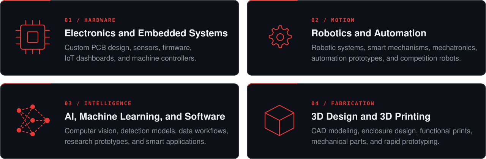

  

## About

Evtech Research Group develops practical research and development systems for education, industry, and emerging technology. We support engineering researchers, students, startups, businesses, the government sector, and semiconductor and non-semiconductor industries, taking projects from concept and prototyping through to working, deployed systems.

| Engineering R&D | Prototype to Deployment | Industry Systems | Global Project Support |
|:---|:---|:---|:---|
| Custom systems built for research, business, and industry. | Design, fabrication, testing, and technical support. | Automation, robotics, electronics, AI, and machine development. | Engineering development and technical assistance worldwide. |

## Services

## Process

## Contact

For research collaborations, prototype development, and industry projects, reach us through the channels below.

**Email:** [contact@evtechph.com](mailto:contact@evtechph.com) 
**Website:** [evtechph.com](https://evtechph.com) 
**Location:** Philippines

---

Project repositories are kept private to protect client and research confidentiality.

